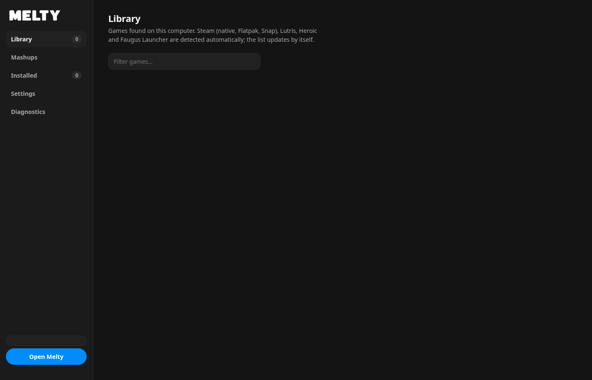
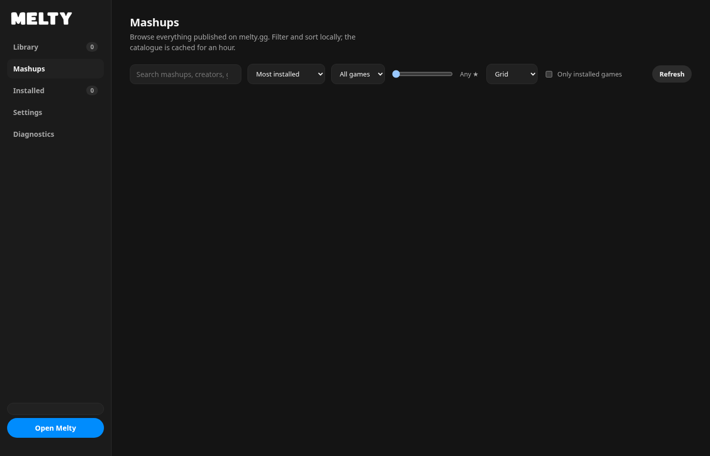
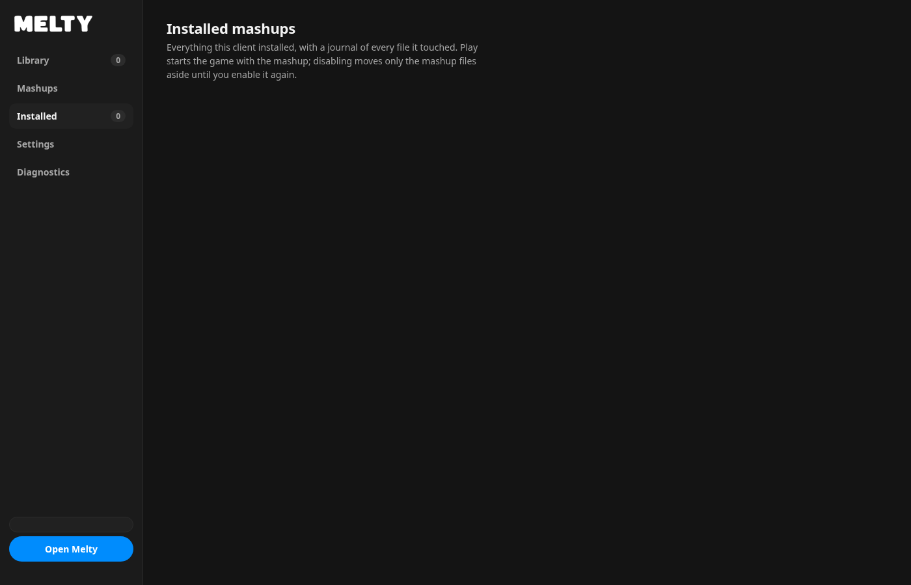
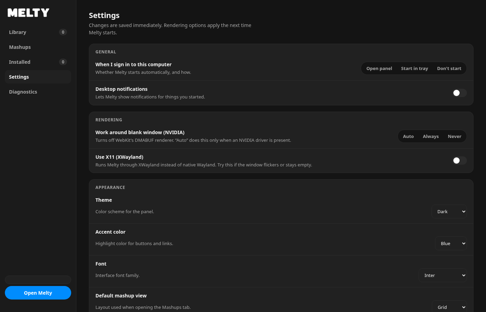
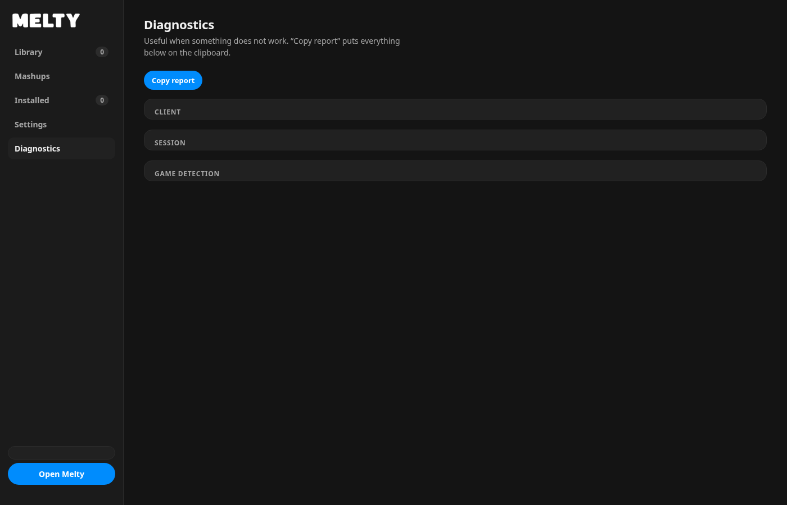

# Melty-Linux

A native, cross-platform client for [melty.gg](https://melty.gg) built with [Tauri 2](https://v2.tauri.app/), Rust and a lightweight web UI. 

**Note:** This is an unofficial community project and is not affiliated with Melty. No code from the official Windows client has been included — this is a clean reimplementation based on the melty.gg web interface.

## Demo

[](screenshots/melty.webm)

[Download/Watch Demo Video](screenshots/melty.webm)

## Screenshots

<details>
<summary><b>Click to expand screenshots</b></summary>

### Library
[](screenshots/library.png)

### Mashup Browser
[](screenshots/mashup-browser.png)

### Mashup Details
[](screenshots/mashup-details.png)

### Installed
[](screenshots/installed.png)

### Settings
[](screenshots/settings.png)

### Diagnostics
[](screenshots/diagnostics.png)

</details>

## Features

- **Native panel UI** — Library, Mashups, Installed, Settings and Diagnostics in one native window (no embedded website main window).
- **Game library detection** — Automatically detects installed games from Steam (native, Flatpak, Snap), Lutris, Heroic (Epic/GOG/Amazon/Sideload), and Faugus Launcher.
- **Running game detection** — Tracks running processes (including Wine/Proton) and shows running state per game.
- **Mashup browser** — Browse the full melty.gg mashup catalog with search, game filter, sorting (installations, new, updated, rating, name), grid/list views, and infinite scroll/autoload on filter changes.
- **Mashup installation** — Download and install mashups with support for ZIP, 7z and RAR archives (7z/RAR via `bsdtar`/`7z`). Automatic dependency resolution with clear error messages.
- **Mod loaders** — Supports BepInEx 5, BepInEx 6 (IL2CPP), BepInExPack PEAK, MelonLoader, OWML, and Ultimate ASI Loader.
- **Game launching** — Start games with installed mashups through the detected launcher/Steam/Proton/Wine with proper environment setup.
- **Enable/disable & cleanup** — Enable or disable installed mashups, remove them with optional deletion of saved data, and rollback support.
- **Deep links** — Handle `melty://` links to open specific tabs or mashup details directly.
- **Tray integration** — System tray with quick access to the panel.
- **Cross-platform** — Runs on Linux and Windows. Game detection, launching, and process management work on both platforms.
- **Caching** — Local catalog cache (valid for 60 minutes) for fast filtering/sorting.

## How it works

- **Game detection**: The `melty-games` crate scans known launcher paths and library manifests (Steam VDF, Lutris configs, Heroic manifests, Faugus configs) to build a unified game list.
- **Process tracking**: On Linux it inspects `/proc` (with Wine/Proton path resolution); on Windows it uses `tasklist` to detect running games.
- **Mashup data**: Fetched directly from public melty.gg JSON endpoints (`/api/mods`, `/api/mods/<slug>`), cached locally in the app data directory.
- **Installation**: Archives are downloaded and unpacked to the appropriate game/mod directories. Installations are journaled for safe enable/disable/remove operations.
- **Launching**: The app spawns the game/launcher with the correct environment (Steam/Proton/Wine paths, prefixes, app IDs) and tracks running processes.
- **UI**: A native Tauri window loads `ui/panel.html` with vanilla JS/CSS (no framework dependencies). All backend communication goes through Tauri commands.

## Installation

### Linux

#### Arch Linux / CachyOS / Manjaro
```bash
sudo pacman -S rust webkit2gtk-4.1 gtk3 libayatana-appindicator librsvg openssl base-devel
```

For 7z/RAR support (optional but recommended):
```bash
sudo pacman -S p7zip unrar
# or
sudo pacman -S libarchive  # provides bsdtar
```

#### Ubuntu / Debian
```bash
sudo apt install rustc cargo libwebkit2gtk-4.1-dev libgtk-3-dev libayatana-appindicator3-dev librsvg2-dev libssl-dev build-essential
```

For 7z/RAR support:
```bash
sudo apt install p7zip-full unrar
# or
sudo apt install libarchive-tools  # bsdtar
```

#### Fedora
```bash
sudo dnf install rust cargo webkit2gtk4.1-devel gtk3-devel libayatana-appindicator-gtk3-devel librsvg2-devel openssl-devel
```

#### Prebuilt packages
Download the latest release from [Releases](https://github.com/MeckeDev/melty-linux/releases) for your distribution:
- `.AppImage` — universal, no installation required (make executable: `chmod +x *.AppImage`)
- `.deb` — Debian/Ubuntu: `sudo dpkg -i melty-linux_*.deb`
- `.rpm` — Fedora/RHEL/openSUSE: `sudo rpm -i melty-linux_*.rpm`

### Windows

#### Prebuilt packages
Download the latest release from [Releases](https://github.com/MeckeDev/melty-linux/releases):
- `.exe` (NSIS installer) — Recommended, installs to Program Files with Start Menu/desktop shortcuts
- `.msi` — Windows Installer package for enterprise/system-wide installs

Run the installer and launch "Melty Linux Client" from the Start Menu.

#### Notes for Windows
- Steam installations are auto-detected from standard paths (`C:\Program Files (x86)\Steam`, etc.)
- For games running through Proton/Wine on Linux compatibility layers it's not needed, but on native Windows Steam it's fully supported
- The app uses native Windows file dialogs and process management

## Building from source

### Prerequisites
- [Rust](https://rustup.rs/) >= 1.90
- [Node.js](https://nodejs.org/) (not strictly required for the UI, it's static HTML/JS/CSS)
- [Tauri CLI](https://v2.tauri.app/start/prerequisites/): `cargo install tauri-cli --version "^2"`

### Linux build
```bash
git clone https://github.com/MeckeDev/melty-linux.git
cd melty-linux
cargo build -p melty-linux
cargo run -p melty-linux
```

### Build release packages (Linux)
```bash
cargo tauri build
```
Outputs will be in `src-tauri/target/release/bundle/` (`appimage/`, `deb/`, `rpm/`).

### Windows build

#### On Windows
```bash
git clone https://github.com/MeckeDev/melty-linux.git
cd melty-linux
cargo tauri build
```
Outputs in `src-tauri/target/release/bundle/` (`nsis/`, `msi/`).

#### Cross-compile from Linux to Windows
```bash
rustup target add x86_64-pc-windows-gnu
sudo apt install mingw-w64 nsis  # Debian/Ubuntu
# or
sudo pacman -S mingw-w64-gcc nsis  # Arch

cargo tauri build --target x86_64-pc-windows-gnu
```
Outputs in `src-tauri/target/x86_64-pc-windows-gnu/release/bundle/` (`nsis/`, `msi/`).

**Note:** Building all platforms from a single Linux machine isn't possible natively — for multi-platform releases, use a GitHub Actions matrix (Windows, Linux, macOS runners).

### Testing
```bash
cargo test --workspace
```

## Configuration & Data

App data is stored in the platform-appropriate directory:
- **Linux:** `~/.local/share/gg.melty.linux-client/`
- **Windows:** `%APPDATA%\gg.melty.linux-client\`

This includes:
- Authentication token (`melty-token`, mode 0600 on Linux)
- Mashup catalog cache (`mashup-catalog.json`)
- Installation journal and settings

## Troubleshooting

### Linux
- **Empty window on NVIDIA + Wayland:** The app automatically sets `WEBKIT_DISABLE_DMABUF_RENDERER=1` if not already set. If issues persist, try running with XWayland or disable GPU acceleration.
- **Tray not showing:** Ensure you have `libayatana-appindicator` installed.
- **7z/RAR not extracted:** Install `p7zip`/`unrar` or `libarchive` (`bsdtar`).

### Windows
- **Games not detected:** Ensure Steam is installed in a standard location or has library folders configured.
- **File dialogs don't appear:** This is rare; the app falls back to PowerShell folder picker if needed.

## License

MIT License — see [LICENSE](LICENSE) for details.

## Disclaimer

This project is not endorsed by or affiliated with melty.gg. Use at your own risk.
